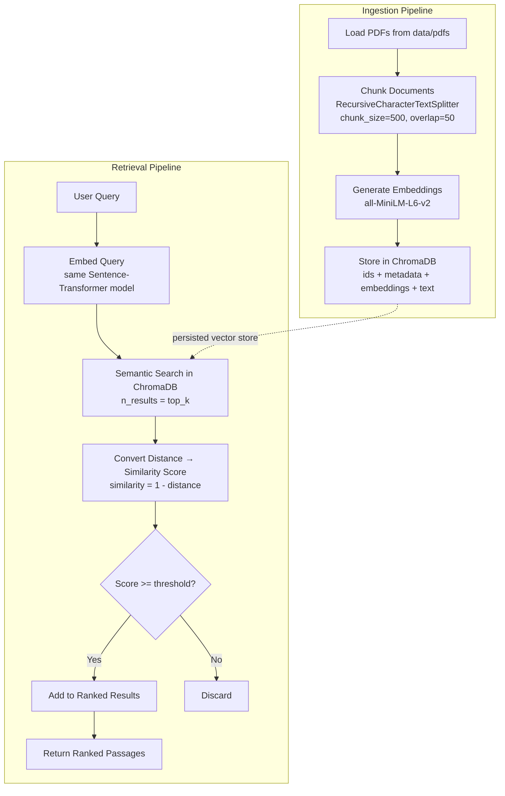

# 🔎 Retrieval-Augmented Generation (RAG) Pipeline

> A document retrieval and semantic search pipeline built with **LangChain**, **ChromaDB**, and **Sentence-Transformers** — ingest PDFs, chunk them, embed them, and retrieve the most relevant passages for any query. 

---

## 📌 Overview

| | |
|---|---|
|  **Task** | Semantic document retrieval (query → ranked relevant passages) |
|  **Loaders** | `TextLoader`, `PyPDFLoader` (LangChain document loaders) |
|  **Chunking** | `RecursiveCharacterTextSplitter` (500 chars/chunk, 50 overlap) |
|  **Embeddings** | `sentence-transformers` — `all-MiniLM-L6-v2` |
|  **Vector store** | ChromaDB (persistent, local) |
|  **Similarity** | Cosine similarity (via distance from ChromaDB query) |
|  **Language** | Python (Jupyter Notebook) |

---

## ✨ Features

-  Bulk-loads all PDFs from a folder and tracks page/document counts
-  Recursive character-based chunking with configurable size & overlap
-  `EmbeddingManager` — wraps Sentence-Transformers for clean, reusable embedding generation
-  `VectorStoreManager` — wraps ChromaDB with a persistent client, auto-creates collections, and stores IDs/metadata/embeddings together
-  `RAGRetriever` — encodes a query, runs semantic search, converts distance → similarity score, and returns ranked results
-  Configurable `top_k` and `score_threshold` for retrieval tuning
-  Tested on a research-paper corpus, retrieving passages for technical queries like *"What is encoder-decoder"*

---

## 🔄 How It Works — Pipeline Flowchart



---

## 🗂️ Repo Structure

```
.
├── rag_pipeline.ipynb              
├── requirements.txt          
├── .gitignore                 
└── README.md                  
```

---

## 🛠️ Setup

```bash
# 1️ Clone the repo
git clone https://github.com/kalyanitangade4/rag-pipeline.git
cd rag-pipeline

# 2️ Create a virtual environment
python -m venv venv
source venv/bin/activate   # Windows: venv\Scripts\activate

# 3️ Install dependencies
pip install -r requirements.txt
```

---

## 📚 Data Setup

1.  Place any `.txt` file (e.g. `Python.txt`) in `data/` to test the `TextLoader`.
2.  Create a `data/pdfs/` folder and drop in any PDFs you want to index (e.g. research papers).
3.  The vector store will be auto-created at `data/vector_store/` the first time you run the ingestion cells.

---

## 🏗️ Running the Pipeline

Open `rag_pipeline.ipynb` and run the cells in order:

1.  **Load documents** — `load_all_pdfs()` reads every PDF in `data/pdfs/`
2.  **Chunk** — `split_docs()` splits documents into overlapping chunks
3.  **Embed** — `EmbeddingManager` encodes each chunk with `all-MiniLM-L6-v2`
4.  **Store** — `VectorStoreManager.add_documents()` persists chunks + embeddings to ChromaDB
5.  **Retrieve** — `RAGRetriever.retrieve(query, top_k=5)` returns the top-k most relevant chunks, ranked by similarity score

**Example:**

```python
rag_retriever = RAGRetriever(embedding_manager, vector_store)
results = rag_retriever.retrieve("What is encoder decoder", top_k=5)

for r in results:
    print(r["rank"], r["similarity_score"], r["document"][:100])
```

---

## ⚠️ Notes & Limitations

-  This is a **retrieval-only** pipeline — it returns ranked passages, but does not yet call an LLM to generate a final answer (no "generation" step wired in).
-  Embedding model is `all-MiniLM-L6-v2` — fast and lightweight, but swap in a larger model (e.g. `all-mpnet-base-v2`) for higher retrieval accuracy if compute allows.
-  ChromaDB is used in **persistent local mode** — for production use, consider a managed vector DB (Pinecone, Weaviate, Qdrant) or ChromaDB's client-server mode.
-  `VectorStoreManager.add_documents()` currently re-adds the growing `ids`/`metadata`/`documents` lists inside the loop — for large corpora, batch the `.add()` call outside the loop for better performance.

---

## 🙋 Author

**Kalyani Tangade**
📧 kalyanitangade4@gmail.com
🐙 [github.com/kalyanitangade4](https://github.com/kalyanitangade4)
